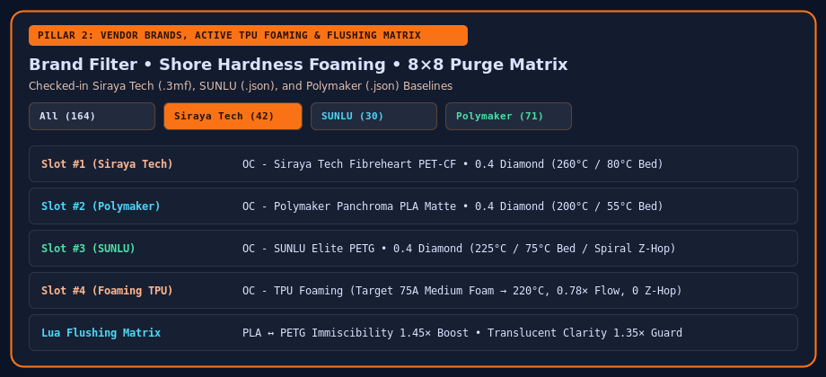

# Filaments, Vendor Brands & Flushing Matrix

The **3. Filaments & Base Deltas** tab manages your active AMS / ACE Pro slots, reserve spool bank, vendor polymer catalog, specialty finishes, and multi-material flushing volume matrix.

## Official Vendor Profiles & Brand Filtering

The built-in polymer catalog integrates checked-in vendor presets generated via Bazel (`//:vendor_catalog_gen` using `rules_python`):

- **Siraya Tech**: 42 official `.3mf` filament profiles (Fibreheart ABS-CF, ASA-GF, PAHT-CF, PET-CF, PPA-CF, PPS-CF, Flex TPU 85A/95A, Rebound PEBA 95A, Cast, etc.).
- **SUNLU**: 30 official Preset Manager profiles (PLA+, High Speed PLA, Silk PLA+, Matte PLA, PETG, Elite PETG, ABS, ASA, TPU 95A, PA6-CF, PC-ABS, PCL).
- **Polymaker**: 71 official Preset Manager profiles (PolyLite, PolyMax, PolyTerra, Panchroma Matte/Silk/Marble/Glow/CoPE, Fiberon PA6-CF20 / PA612-CF15 /PA12-CF10 / PET-CF17 / PPS-CF10).

Use the **Brand** filter bar (`All`, `Anycubic`, `Siraya Tech`, `SUNLU`, `Polymaker`, `Bambu Lab`, `eSUN`, `Overture`, `Generic`) to quickly filter spools when building your loadout.

## Active Foaming TPU & Variable Shore Hardness

When you select the **`Foaming`** finish on a TPU spool (such as Varioshore TPU or Siraya Tech Flex foaming), the **Active Foaming & Shore Hardness Schedule** panel unlocks:

- Pick a target Shore hardness (`92A Unfoamed`, `85A Light Foam`, `75A Medium Foam`, `65A High Foam`, `55A Max Micro-Cell Foam`).
- The configurator automatically maps your target hardness to the foaming activation temperature (`195°C`–`240°C`), adjusts `filament_flow_ratio` (`1.00` down to `0.62` to compensate for `1.6×` micro-cell expansion), zeroes Z-hop and retraction wipe, and caps volumetric speed.

## Pigment & Opacity-Aware Flushing Matrix

At the bottom of the Filament tab, the **Lua Flushing Volume Matrix** computes every `From → To` purge volume (`mm³`) across 4 or 8 slots by modeling:
1. **Color Luminance Distance & Pigment Stickiness** (dark-to-light transitions require aggressive purging).
2. **Polymer Immiscibility Penalty** (`PLA ↔ PETG/PCTG` or `Support ↔ Model` transitions inject a `1.45×` chemical separation purge to prevent layer delamination).
3. **Translucent Optical Clarity** (purging into a translucent spool boosts flush volume so residual opaque pigment does not cloud the part).
