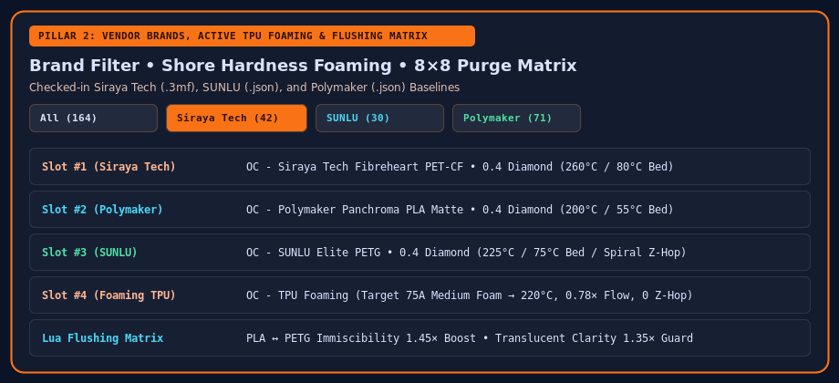

# Filaments, Vendor Brands & Flushing Matrix

The **3. Filaments & Base Deltas** tab manages your active AMS / ACE Pro slots, reserve spool bank, vendor polymer catalog, specialty finishes, and multi-material flushing volume matrix.

## Official Vendor Profiles & Brand Filtering

The built-in polymer catalog integrates checked-in vendor presets generated via Bazel (`//:vendor_catalog_gen` using `rules_python`):

- **Siraya Tech**: 42 official `.3mf` filament profiles (Fibreheart ABS-CF, ASA-GF, PAHT-CF, PET-CF, PPA-CF, PPS-CF, Flex TPU 85A/95A, Rebound PEBA 95A, Cast, etc.).
- **SUNLU**: 30 official Preset Manager profiles (PLA+, High Speed PLA, Silk PLA+, Matte PLA, PETG, Elite PETG, ABS, ASA, TPU 95A, PA6-CF, PC-ABS, PCL).
- **Polymaker**: 71 official Preset Manager profiles (PolyLite, PolyMax, PolyTerra, Panchroma Matte/Silk/Marble/Glow/CoPE, Fiberon PA6-CF20 / PA612-CF15 /PA12-CF10 / PET-CF17 / PPS-CF10).

Use the **Brand** filter bar (`All`, `Anycubic`, `Siraya Tech`, `SUNLU`, `Polymaker`, `Bambu Lab`, `eSUN`, `Overture`, `Generic`) to quickly filter spools when building your loadout.

## Active Foaming TPU & Variable Shore Hardness

When you select the **`Foaming`** finish on a TPU spool (such as colorFabb varioShore TPU, eSUN eTPU-LW, or Siraya Tech Flex TPU Air) or enable the **Active-Foaming TPU Shore Hardness & Expansion Tuner** (`cal_tpu_foaming_shore.lua`, priority `53`), the **Active Foaming & Shore Hardness Schedule** panel unlocks:

- Pick a target Shore hardness (`92A Unfoamed`, `85A Light Foam`, `75A Medium Foam`, `65A High Foam`, `60A / 55A Max Micro-Cell Foam`).
- The configurator automatically maps your target hardness to the foaming activation temperature (`195°C`–`245°C`), adjusts `filament_flow_ratio` (`0.98` down to `0.60` to compensate for `1.6×` micro-cell expansion), caps `filament_max_volumetric_speed` to preserve melt-zone residence time, zeroes Z-hop (`0.00mm`), and protects foaming retraction from generic nozzle PWL overrides.

## ACE Pro / AMS Multi-Spool I/O (`.3mf` & Spoolman)

You can import and export your entire multi-slot AMS / ACE Pro filament loadout across:
- **`.3mf` Project Containers**: Importing a `.3mf` file extracts all slot filaments, hex colors, printer settings (`printer_settings_id`), and per-slot overrides (`nozzle_temperature`, `filament_flow_ratio`, `pressure_advance`, `filament_retraction_length`, `filament_z_hop`). Exporting a `.3mf` writes per-slot Lua-resolved columns so each slot carries its own polymer's exact PWL & coupled-physics values.
- **Spoolman Inventory Sync**: Import/export `/api/v1/spool` JSON snapshots in the browser, or use 1-click LAN Pull (`🔄 Pull Inventory`) & Calibration Push (`⬆️ Spoolman`) in the Tauri desktop app to auto-map `ACE 1..8` locations and sync calibrated `flow_ratio`, `pressure_advance`, and `max_volumetric_speed`.

## Pigment, Opacity & Coupled Residence-Time Flushing Matrix

At the bottom of the Filament tab, the **Lua Flushing Volume Matrix** (`transformations/flush_volumes_matrix.lua`, priority `60`) computes every `From → To` purge volume (`mm³`) across 4 or 8 slots by modeling:
1. **Color Luminance Distance & Pigment Stickiness**: Dark-to-light transitions (`Black/Red/Blue → White/Yellow/Natural`) require aggressive boundary-layer purging.
2. **Polymer Immiscibility Guard**: `PLA ↔ PETG/PCTG/ASA/ABS` transitions enforce an `800 mm³` chemical separation purge (with `240°C` transition hold in `symptom_clog_ace_pro.lua`) so residual PLA does not delaminate functional PETG layers.
3. **Translucent Optical Clarity**: Purging into a translucent spool boosts flush volume (`1 / opacity`) so residual opaque pigment does not cloud the part.
4. **Coupled Hotend Residence-Time & Wall-Slip Factor (`coupled_purge_factor(config, ctx)`)**: Scales off-diagonal purge volumes by $\gamma_{\text{purge}}(L_{\text{melt}}, \mu_{\text{nozzle}}, \Delta T_{\text{net}}) \in [0.70, 1.65]$, accounting for the FlowTech melt-zone volume (`1.25×`), DiamondBack PCD low-friction wall slip (`0.80×` boundary-layer evacuation, neutralizing the extra FlowTech internal volume at thermal equilibrium), and cold-melt viscosity shifts ($+0.8$% per $-\text{°C}$). See [`doc/coupled-parameter-physics-math.md`](coupled-parameter-physics-math.md) §6.
