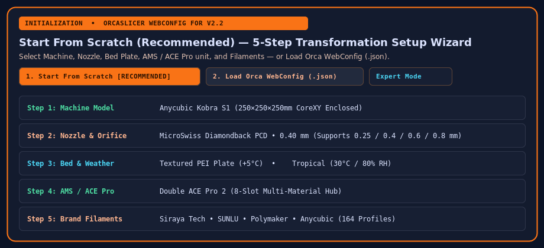

# Getting Started & Initialization

When you open **OrcaSlicer WebConfig**, the application starts in a clean state and presents the **Initialization** modal.

## 1. Start From Scratch (Recommended & Default)

**Start From Scratch** is the default, recommended workflow. It walks you through a 5-step guided wizard to build a clean transformation stack:

1. **Step 1 — Machine**: Select your printer model (`Anycubic Kobra S1`, `Anycubic Kobra 3`, `Bambu Lab X1C`, `Voron 2.4`, etc.).
2. **Step 2 — Nozzle & Hotend**: Choose your nozzle architecture (Factory Brass, Hardened Steel, Ruby-Tipped Brass, or **MicroSwiss FlowTech** Plated Brass / CM2 / CHT / CHT CM2 / Diamondback PCD) and select a manufactured orifice diameter (`0.20mm` through `1.00mm`).
3. **Step 3 — Bed Plate & Add-Ons**: Select your build plate (`Textured PEI`, `Smooth High-Temp PEI`, `Cool Plate / CryoGrip`) and any physical toolhead upgrades.
4. **Step 4 — Multi-Material Hub (AMS / ACE Pro)**: Configure Single (4-Slot), Double (8-Slot), or External Spool mode.
5. **Step 5 — Filament Loadout**: Filter the catalog by **Brand** (`All`, `Anycubic`, `Siraya Tech`, `SUNLU`, `Polymaker`, `Bambu Lab`, `eSUN`, `Overture`, `Generic`) and **Category**, and add spools to your slots.

## 2. Load Orca WebConfig (`.json`)

If you previously exported your configuration state using **Export → Export Orca WebConfig (`.json`)**, click **2. Load Orca WebConfig** to restore your entire versioned state (`config_version`, rigs, spools, processes, and custom Lua transformations) in one click.

## 3. Expert Mode (Raw Slicer Directory & `.zip` Archive Import)

Expanding **Expert Mode** allows advanced users to import an existing flat OrcaSlicer / AnycubicSlicerNext `.zip` backup archive (or scan a local slicer directory in the Tauri desktop app) and automatically reconstruct its parameters into base profiles + Lua transformation rules, flagging any one-off manual drift for review.

---

## 4. Feature Matrix: Static Website vs. Portable Desktop Client (Tauri)

OrcaSlicer WebConfig runs from the same Rust + WebAssembly codebase in two deployment modes:
1. **🌐 Static Website (GitHub Pages / Browser)**: 100% static client-side WebAssembly with zero outbound network calls. Ideal for generating `.3mf` loadouts, `.zip` profile bundles, and `orcaslicer_webconfig.json` snapshots anywhere without installing software.
2. **🖥️ Portable Desktop Client (Tauri v2)**: A single-file standalone executable (`Windows .exe`, `Linux x64`, `macOS`) that pairs the WASM UI with an embedded native Rust backend for direct local slicer directory access and unrestricted local LAN HTTP integrations (Spoolman, Moonraker, and Anycubic printer discovery).

| Feature / Capability | 🌐 Static Website (Browser) | 🖥️ Portable Desktop Client (Tauri) |
| :--- | :--- | :--- |
| **Zero Server Storage / Privacy** | ✅ 100% static in browser (`localStorage` + file download/upload) | ✅ Single-file native executable; all data stays on your machine |
| **5-Step Rig, Nozzle & Weather Wizard** | ✅ Full support | ✅ Full support |
| **Sandboxed Lua 5.4 Transformation Engine** | ✅ Full support (including Kobra S1 `G9111` & 5-Tab G-Code Optimizers) | ✅ Full support (including Kobra S1 `G9111` & 5-Tab G-Code Optimizers) |
| **Parameter Provenance & Lineage Inspector (`🧬`)** | ✅ Full step-by-step causal chain & colored diffs | ✅ Full step-by-step causal chain & colored diffs |
| **4-Slot / 8-Slot ACE Pro & AMS Flushing Matrix** | ✅ Full physics & pigment-aware matrix calculator | ✅ Full physics & pigment-aware matrix calculator |
| **Export / Import `.3mf`, `.zip` & `.json` Snapshots** | ✅ Via browser file download & file picker | ✅ Via native save/open dialogs or direct disk write |
| **Auto-Discover Local `AnycubicSlicerNext` / `OrcaSlicer` Directory** | ❌ Browser sandbox prevents automatic `%APPDATA%` scanning | ✅ Auto-detects `%APPDATA%\AnycubicSlicerNext` & `OrcaSlicer` on startup |
| **One-Click Direct Disk Save & `.conf` Patching** | ⚠️ Requires downloading `.zip` / `.3mf` (or Chromium File System Access API) | ✅ Direct capability-sandboxed (`cap-std`) disk read/write + `.bak` backups |
| **Spoolman Inventory — JSON Snapshot Import / Export** | ✅ Import/Export `/api/v1/spool` JSON files & auto-map `ACE 1..8` locations | ✅ Full support |
| **Spoolman Inventory — Live LAN Pull & Calibration Push** | ❌ Blocked by browser HTTPS→HTTP mixed-content & CORS rules | ✅ Native LAN HTTP sync (`🔄 Pull Inventory`) & 1-click `⬆️ Spoolman` `PATCH` push (`flow_ratio`, `pressure_advance`, `max_volumetric_speed`, temps, slot location) |
| **Moonraker Active-Spool Sync (`📡 Moonraker`, Optional)** | ❌ Blocked by browser mixed-content & CORS rules | ✅ 1-click `POST /server/spoolman/spool_id` to track live print weight in Spoolman |
| **Anycubic Kobra S1 / ACE Pro Auto-Sniff & Sync** | ⚠️ Offline `.conf` / `.zip` import & export only | ✅ Auto-sniffs local `AnycubicSlicerNext.conf` (`current_device_id`, `ams_filament_ids`, `anycubic_presets`) + LAN/Cloud printer sync |
