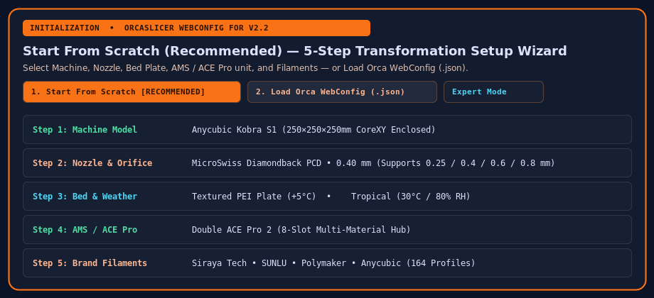

# Getting Started & Initialization

When you open **OrcaSlicer WebConfig**, the application starts in a clean state and presents the **Initialization** modal.

## 1. Start From Scratch (Recommended & Default)

**Start From Scratch** is the default, recommended workflow. It walks you through a 5-step guided wizard to build a clean transformation stack:

1. **Step 1 — Machine**: Select your printer model (`Anycubic Kobra S1`, `Anycubic Kobra 3`, `Bambu Lab X1C`, `Voron 2.4`, etc.).
2. **Step 2 — Nozzle & Hotend**: Choose your nozzle architecture (Factory Brass, Hardened Steel, Ruby-Tipped Brass, or **MicroSwiss FlowTech** Plated Brass / CM2 / CHT / CHT CM2 / Diamondback PCD) and select a manufactured orifice diameter (`0.20mm` through `1.00mm`).
3. **Step 3 — Bed Plate & Add-Ons**: Select your build plate (`Textured PEI`, `Smooth High-Temp PEI`, `Cool Plate / CryoGrip`) and any physical toolhead upgrades.
4. **Step 4 — Multi-Material Hub (AMS / ACE Pro)**: Configure Single (4-Slot), Double (8-Slot), or External Spool mode.
5. **Step 5 — Filament Loadout**: Filter the catalog by **Brand** (`All`, `Anycubic`, `Siraya Tech`, `SUNLU`, `Polymaker`, `Bambu Lab`, `eSUN`, `Overture`, `Generic`) and **Category**, and add spools to your slots.

## 2. Load Orca WebConfig (`.json`)

If you previously exported your configuration state using **Export → Export Orca WebConfig (`.json`)**, click **2. Load Orca WebConfig** to restore your entire versioned state (`config_version`, rigs, spools, processes, and custom Lua transformations) in one click.

## 3. Expert Mode (Raw Slicer Directory & `.zip` Archive Import)

Expanding **Expert Mode** allows advanced users to import an existing flat OrcaSlicer / AnycubicSlicerNext `.zip` backup archive (or scan a local slicer directory in the Tauri desktop app) and automatically reconstruct its parameters into base profiles + Lua transformation rules, flagging any one-off manual drift for review.
