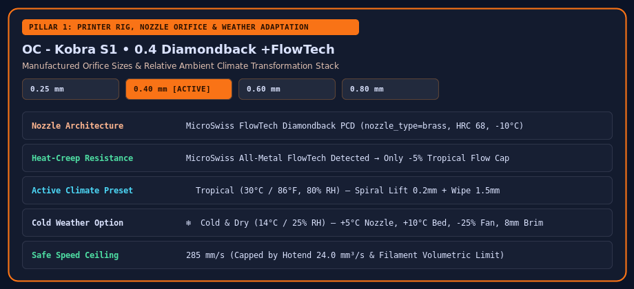

# Printer Rigs, Nozzles & Weather Adaptation

The **2. Printer & Rig Vault** tab manages your hardware configurations, nozzle orifice geometry, cooling modifications, and ambient weather compensation.

## Nozzle Materials & Manufactured Orifice Sizes

When you select a nozzle type on a rig, OrcaSlicer WebConfig automatically constrains the available orifice diameters to the sizes manufactured for that nozzle family and applies the corresponding thermal and volumetric Lua rules:

- **MicroSwiss Diamondback PCD** (`0.25mm`, `0.40mm`, `0.60mm`, `0.80mm`): Polycrystalline diamond tip (`HRC 68`). Lowers nozzle temperature by `-10°C`, sets `nozzle_type = brass` with `nozzle_hrc = 68` so OrcaSlicer permits abrasive `-CF`/`-GF` filaments without forcing Hardened Steel thermal lag, and tightens retraction to `0.60mm`.
- **MicroSwiss FlowTech CHT CM2 & CM2** (`0.40mm`, `0.60mm`, `0.80mm`): Copper-core body with hardened M2 HSS tip (`HRC 55`) and high-flow split melt zone.
- **MicroSwiss FlowTech CHT High-Flow** (`0.40mm`, `0.60mm`, `0.80mm`, `1.00mm`): Boosts volumetric flow capacity by `+25%`.
- **MicroSwiss FlowTech Plated Brass (TwinClad XT)** (`0.20mm`, `0.30mm`, `0.40mm`, `0.60mm`, `0.80mm`, `1.00mm`): Low-friction nickel-composite coating (`HRC 35`).
- **Hardened Steel** (`0.20mm`–`1.00mm`): Adds `+5°C` thermal conductivity compensation (`HRC 55`).

## Ambient Weather & Humidity Stacking

Ambient room temperature and relative humidity drastically alter polymer behavior inside enclosed CoreXY printers:

### Tropical / Hot & Humid (`30°C / 80% RH`)
- **Heat-Creep Protection**: Lowers PLA/Silk nozzle temperatures (`-8°C`), drops PLA bed temperature to `55°C` (below PLA's `~60°C` glass transition), and reduces max volumetric speed by `15%` on stock hotends (or `5%` on heat-creep-resistant MicroSwiss / FlowTech / Diamondback hotends).
- **Anti-Stringing Geometry**: Switches Z-Hop to **`Spiral Lift`** (`0.20mm`) to shear humid ooze strands sideways, enables `wipe` (`1.5mm`), and enables `reduce_crossing_wall`.
- **Enclosure Exhaust**: Drives part cooling and chamber exhaust fans to `80–100%` for PLA/TPU while keeping `ABS/ASA` and `PA/PC` enclosed.

### Cold Weather / Winter Garage (`14°C / 25% RH`)
- **Anti-Warping & Inter-Layer Bonding**: Boosts nozzle temperatures `+5°C to +10°C` to counter cold-air viscosity spikes, raises bed temperatures `+5°C to +10°C`, scales part-cooling fans down `-25%`, slows first-layer speed to `30 mm/s`, and enables outer brims (`8mm`) and draft shields for warp-prone polymers.
