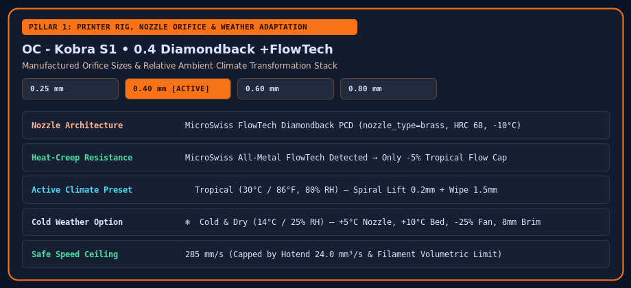

# Printer Rigs, Nozzles & Weather Adaptation

The **2. Printer & Rig Vault** tab manages your hardware configurations, kinematics motion class, nozzle orifice geometry, cooling modifications, and ambient weather compensation.

## 380+ Printers Across CoreXY & Bed-Slinger Motion Classes

The generated OrcaSlicer hardware catalog (`//:orcaslicer_catalog_gen`) indexes **380+ printers across 66 vendors** alongside curated hardware limits in [`constants.json`](../constants.json):

- **Kinematics Motion Class (`corexy` vs. `bedslinger`)**: Every rig is classified into a motion class exposed to Lua transformations via `ctx.printer_kinematics_class`, `ctx.travel_accel_target_mm2`, and `ctx.travel_accel_floor_mm2`:
  - **CoreXY Class** (`Anycubic Kobra S1`, `Kobra S1 Max`, `Bambu Lab X1C / P1S`, `Voron 2.4`, etc.): Stock travel acceleration `10,000 mm/s²`, breakaway target `12,000 mm/s²` (floor `9,000 mm/s²`).
  - **Bed-Slinger Class** (`Anycubic Kobra 3`, `Bambu Lab A1 / A1 Mini`, `Creality Ender-3`, `Prusa MK4 / MINI`, `Sovol SV06/07`, etc.): Stock travel acceleration `6,000 mm/s²`, gentler breakaway target `8,000 mm/s²` (floor `5,000 mm/s²`) to avoid Y-bed ringing.
- **Per-Machine Hotend Thermal Ceiling (`ctx.hotend_max_temp_c`)**: Intersects nozzle rules with the printer's physical hotend rating (e.g. `300°C` on Kobra S1 / Bambu X1C with FlowTech vs. `260°C` on PTFE-lined Ender-3 hotends).

## Nozzle Materials, Manufactured Orifice Sizes & PWL Curves

When you select a nozzle type on a rig, OrcaSlicer WebConfig constrains the available orifice diameters to the sizes manufactured for that nozzle family and evaluates composable piecewise-linear (PWL) and coupled-physics rules (`P10 thermal_conductivity.lua`, `P12 rig_addons_cooling.lua`, and `P25 symptom_stringing_diamondback.lua`):

- **MicroSwiss Diamondback PCD** (`0.25mm`, `0.40mm`, `0.60mm`, `0.80mm`, `1.00mm`): Polycrystalline diamond tip (`543 W/m·K`, `CoF 0.01`, `HRC 68`). Evaluates a regime-aware PWL temperature curve (`-11°C` on high-fan PLA, `-10°C` on PETG, tapering to `-5°C` at `300°C` to preserve inter-layer welds on ABS/ASA/PA-CF/PC), applies a quadratic die-swell flow trim (`0` to `-1.2%` scaled by $\sqrt{0.4/d}$), sets `nozzle_type = brass` with `nozzle_hrc = 68`, and composes with the FlowTech viscoelastic retraction curve (`P12`) and PCD anti-stringing rule (`P25`). See [`doc/pwl-nozzle-compensation-math.md`](pwl-nozzle-compensation-math.md) for the complete mathematics.
- **MicroSwiss FlowTech CHT CM2 & CM2** (`0.40mm`, `0.60mm`, `0.80mm`): Copper-core body with hardened M2 HSS tip (`HRC 55`) and high-flow split melt zone.
- **MicroSwiss FlowTech CHT High-Flow** (`0.40mm`, `0.60mm`, `0.80mm`, `1.00mm`): 3-bore internal splitter boosts Graetz volumetric flow capacity (`c_bore = 1.15×`, scaling up with orifice diameter $(d/0.40)^{0.38}$).
- **MicroSwiss FlowTech Plated Brass (TwinClad XT)** (`0.20mm`, `0.30mm`, `0.40mm`, `0.60mm`, `0.80mm`, `1.00mm`): Low-friction nickel-composite coating (`HRC 35`).
- **Ruby-Tipped Brass (`ruby_brass`)** (`0.40mm`, `0.60mm`, `0.80mm`): `0°C` Brass thermal conductivity baseline with `HRC 60` synthetic ruby tip for abrasive `-CF` / `-GF` composites.
- **Hardened Steel** (`0.20mm`–`1.00mm`): Adds `+5°C` thermal conductivity compensation (`HRC 55`) to overcome radial conduction lag.

## Ambient Weather & Humidity Stacking (`sym_weather_climate.lua`)

Ambient room temperature and relative humidity drastically alter polymer behavior inside enclosed and open-frame printers. All weather rules execute 100% in Lua (`transformations/parametric/sym_weather_climate.lua`, priority `54`) as relative offsets and multipliers on top of your nozzle and filament baseline:

### Tropical / Hot & Humid (`30°C / 80% RH`)
- **Heat-Creep Protection (Nozzle-Aware)**: Lowers PLA/Silk/PETG nozzle temperatures (`-10°C` on stock hotends, halved to `-5°C` on heat-creep-resistant MicroSwiss FlowTech / Diamondback hotends), drops PLA bed temperature (`-5°C` stock / `-3°C` MicroSwiss), and scales Max Volumetric Speed (`0.85×` stock / `0.94×` MicroSwiss on PLA; `0.78×` stock / `0.90×` MicroSwiss on Silk/PETG).
- **Anti-Stringing Geometry**: Switches Z-Hop to **`Spiral Lift`** (`0.20mm`, `Top Only` on PETG, `0mm` on TPU) to shear humid ooze strands sideways, adds `+0.15..+0.35mm` anti-steam retraction, enables `filament_wipe` (`1.5mm`), and enables `reduce_crossing_wall`.
- **Enclosure Exhaust**: Drives part cooling and chamber exhaust fans (`during_print_exhaust_fan_speed`) to `80–100%` for PLA/TPU while keeping `ABS/ASA` and `PA/PC` enclosed.

### Cold Weather / Winter Garage (`14°C / 25% RH`)
- **Anti-Warping & Inter-Layer Bonding**: Boosts nozzle temperatures `+5°C to +8°C` (`+3°C to +5°C` on high-conductivity MicroSwiss/Diamondback) to counter cold-air viscosity spikes, raises bed temperatures `+5°C` (`+10°C` on initial layer), zeroes the rear exhaust fan (`0%`), adds `+2..+3` no-cooling initial layers, scales part-cooling fans by `0.65×`, slows first-layer speed by `0.70×`, and enables outer brims (`+5–10mm`) or Mouse Ears for warp-prone polymers.
