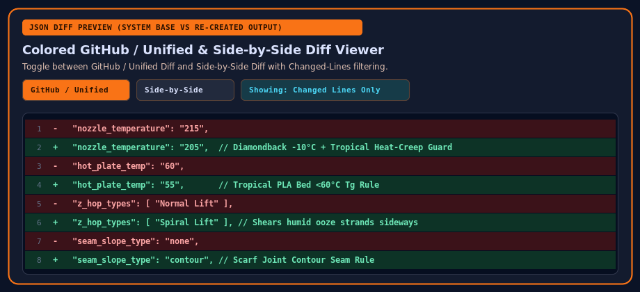

# Architecture & Core Concepts

**OrcaSlicer WebConfig** (for OrcaSlicer v2.2) replaces static, hand-edited slicer profiles with a **computational transformation stack**.

## Why Transformation Stacking?

In traditional 3D printer slicers, every profile is a flat JSON dictionary of absolute values. Whenever you change a physical variable on your printer, that single hardware change ripples across every filament and process profile you own:

| Physical Change | Parameters Affected Across All Profiles |
| :--- | :--- |
| **Nozzle Material** (`Brass` ↔ `Hardened Steel` ↔ `Diamondback PCD` ↔ `CHT CM2`) | `nozzle_temperature` (`+5°C` or `-10°C`), `filament_flow_ratio`, `retraction_length`, `max_volumetric_speed`, `nozzle_hrc` |
| **Nozzle Diameter** (`0.2mm` ↔ `0.25mm` ↔ `0.4mm` ↔ `0.6mm` ↔ `0.8mm` ↔ `1.0mm`) | `nozzle_diameter`, `layer_height`, `line_width`, `max_volumetric_speed` |
| **Bed Surface** (`Textured PEI` ↔ `Smooth PEI` ↔ `CryoGrip Cool Plate`) | `hot_plate_temp`, `hot_plate_temp_initial_layer`, `cool_plate_temp`, `brim_type` |
| **Ambient Weather** (`Temperate` ↔ `Tropical 30°C/80% RH` ↔ `Cold 14°C`) | `nozzle_temperature`, `hot_plate_temp`, `z_hop_types` (`Spiral Lift` vs `Slope Lift`), `fan_max_speed`, `additional_cooling_fan_speed`, `max_volumetric_speed` |
| **Filament Brand & Finish** (`Basic` ↔ `Silk` ↔ `Translucent` ↔ `Foaming TPU` ↔ `-CF`) | Base thermal profile, `outer_wall_speed`, `fan_min_speed`, `filament_flow_ratio`, `flush_volumes_matrix` |

Maintaining `N × M × D × B × W × F` separate profiles by hand means hundreds of files where a single tweak must be copied everywhere.

### The Three-Pillar Relational Model

OrcaSlicer WebConfig separates your setup into three clean pillars plus a Lua transformation stack:

1. **Pillar 1 — Printer & Rig Vault**: Defines the physical printer (`Anycubic Kobra S1`, `Kobra 3`, `Bambu Lab X1C`, `Voron 2.4`), installed nozzle material & orifice diameter, toolhead cooling add-ons, AMS / ACE Pro unit count (4-slot vs. 8-slot), and ambient **Weather & Humidity** posture.
2. **Pillar 2 — Filaments & Base Deltas**: Stores uncompensated vendor/material baselines (including official **Siraya Tech**, **SUNLU**, and **Polymaker** profiles) and computes live deltas for your active nozzle and climate.
3. **Pillar 3 — Process Quality / Speed Tiers**: Provides clean `Quality`, `Standard`, and `Speed` process profiles automatically bounded by the active hotend and filament **Safe Volumetric Speed Ceiling**.
4. **Pillar 4 — Sandboxed Lua Transformation Stack**: Evaluates ordered, relative parameter transformations and logs every modification with a full before/after audit trail.
