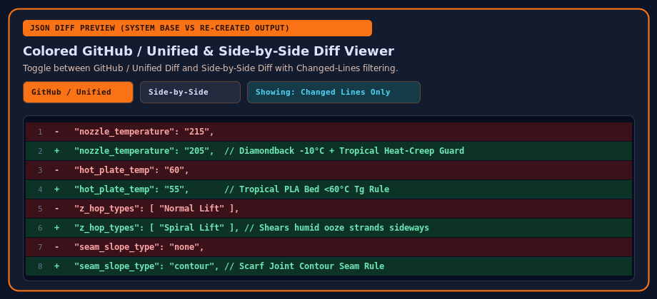

# Architecture & Core Concepts

**OrcaSlicer WebConfig** (for OrcaSlicer v2.2 & Anycubic Slicer Next) replaces static, hand-edited slicer profiles with a **computational transformation stack**.



## Why Transformation Stacking?

In traditional 3D printer slicers, every profile is a flat JSON dictionary of absolute values. Whenever you change a physical variable on your printer, that single hardware change ripples across every filament and process profile you own:

| Physical Change | Parameters Affected Across All Profiles |
| :--- | :--- |
| **Nozzle Material** (`Brass` ↔ `Hardened Steel` ↔ `Diamondback PCD` ↔ `CHT CM2`) | `nozzle_temperature` (`+5°C` or PWL `-5..-11°C`), `filament_flow_ratio`, `filament_retraction_length`, `filament_retraction_speed`, `pressure_advance`, `filament_max_volumetric_speed`, `nozzle_hrc` |
| **Nozzle Diameter** (`0.2mm` ↔ `0.25mm` ↔ `0.4mm` ↔ `0.6mm` ↔ `0.8mm` ↔ `1.0mm`) | `nozzle_diameter`, `layer_height`, per-feature `*_line_width` (`95%–125%` of $d$), `pressure_advance` ($\propto (0.40/d)^{1.35}$), `filament_max_volumetric_speed`, `filament_z_hop`, `ironing_spacing`, `support_object_xy_distance` |
| **Bed Surface** (`Textured PEI` ↔ `Smooth PEI` ↔ `CryoGrip Cool Plate`) | `hot_plate_temp`, `hot_plate_temp_initial_layer`, `cool_plate_temp`, `brim_type`, conditional Z-offset (`-0.03mm` Textured PEI valley squish) |
| **Ambient Weather** (`Temperate` ↔ `Tropical 30°C/80% RH` ↔ `Cold 14°C`) | `nozzle_temperature`, `hot_plate_temp`, `filament_z_hop_types` (`Spiral Lift` vs `Slope Lift`), `fan_max_speed`, `during_print_exhaust_fan_speed`, `filament_max_volumetric_speed`, `brim_width` |
| **Filament Brand & Finish** (`Basic` ↔ `Silk` ↔ `Translucent` ↔ `Foaming TPU` ↔ `-CF`) | Base thermal profile, `outer_wall_speed` (VFA sub-resonance guard), `fan_min_speed`, `filament_flow_ratio`, `flush_volumes_matrix` |

Maintaining `N × M × D × B × W × F` separate profiles by hand means hundreds of files where a single tweak must be copied everywhere.

---

## The Four-Pillar Relational Model

OrcaSlicer WebConfig separates your setup into three clean hardware/material/process pillars plus a 100% Lua transformation stack:

1. **Pillar 1 — Printer & Rig Vault**: Defines the physical printer (`380+` OrcaSlicer printers across `66` vendors, including `Anycubic Kobra S1`, `Kobra S1 Max`, `Kobra 3`, `Bambu Lab X1C/P1S/A1`, `Voron 2.4`, `Creality Ender-3`), motion kinematics class (`CoreXY` vs. `Bed-Slinger`), installed nozzle material & orifice diameter, toolhead cooling/hotend add-ons (`MicroSwiss FlowTech`), AMS / ACE Pro unit count (4-slot vs. 8-slot), and ambient **Weather & Humidity** posture.
2. **Pillar 2 — Filaments & Base Deltas**: Stores uncompensated Brass baselines (including official **Siraya Tech**, **SUNLU**, and **Polymaker** profiles alongside 2,800+ generated OrcaSlicer presets) and evaluates per-spool Lua transformations for your active nozzle and climate.
3. **Pillar 3 — Process Quality / Speed Tiers**: Provides clean `0.12mm Fine`, `0.20mm Quality`, `0.20mm Standard`, `0.20mm Speed`, and `0.28mm Draft` process profiles automatically bounded by the active hotend and filament **Safe Volumetric Speed Ceiling** and **CoreXY Outer-Wall VFA Guard**.
4. **Pillar 4 — Sandboxed Lua Transformation Stack**: Evaluates ordered, relative parameter transformations (`transformations/*.lua`) and records every modification with a full step-by-step provenance ledger and counterfactual shadow audit.

---

## Three-Phase Evaluation Pipeline (`TransformationEngine::evaluate_stack`)

All domain physics and parameter transformations live in Lua (`transformations/*.lua`). Rust is strictly responsible for seeding the baseline, executing the Lua stack, enforcing Epilogue constraints, and performing a single final schema quantization pass:

```text
Phase 1: Seeded Baseline & Read-Only `base` (x0) Snapshot
  │  • Captures uncompensated Brass baseline in immutable `base[key]` table
  │  • Enables `_defer_quantization = "1"` (full IEEE-754 float precision)
  ▼
Phase 2: Ordered Lua Transformation Stack (P10 .. P98)
  │  • Evaluates enabled & in-scope rules in ascending priority order
  │  • Evaluates PWL curves over `base[key]` while composing relatively onto `config[key]`
  │  • Synchronizes coupled physics (`sync_coupled_physics`: PA, MVS, Fans, Purge Factor)
  │  • Canonicalizes shadowed dual-scope keys (`retraction_length` ➔ `filament_retraction_length`)
  │  • Accumulates rule-declared box bounds via `constrain(key, min, max, reason)`
  ▼
Phase 3: Epilogue Constraint Projection (Priority = ∞) & Final Schema Quantization
     • 3.1 Box-Constraint Projection (`bounds[key]`) & Infeasibility Detection (L > U)
     • 3.2 Cross-Key Relational Invariants (Thermal Continuity, Prime ≤ Pull Speed,
           Spiral Z-Hop ≥ 0.5×Layer Height, Fan Max ≥ Min, VFA Speed & Seam Normalization)
     • 3.3 Single Final Schema Quantization (`format_orca_schema_scalar`) across all
           output keys and Provenance / Lineage ledger steps
```

### Companion Mathematical Specifications
- [**Composable PWL Nozzle Compensation Mathematics (`doc/pwl-nozzle-compensation-math.md`)**](pwl-nozzle-compensation-math.md) — Piecewise-linear thermal, flow, retraction, Z-hop, and travel-acceleration curves for `P10`, `P12`, and `P25`.
- [**Coupled Parameter Physics & Multi-Domain Equations (`doc/coupled-parameter-physics-math.md`)**](coupled-parameter-physics-math.md) — Telescoping synchronization for Pressure Advance, Graetz Max Volumetric Speed, Nozzle Tip Radiant Part Cooling, and Residence-Time Flushing Matrices.
