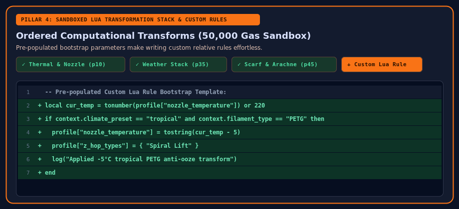

# Lua Recipes, Symptom Wizard & Diff Viewer

The **4. Wizard / Lua Changer** tab lets you diagnose print quality defects, stack pre-built calibration recipes, write custom sandboxed Lua transformations, and inspect the exact parameter changes before exporting.

## Built-In Lua Transformation Stack

Every rule in the transformation stack runs inside our **pure-Rust WebAssembly Lua interpreter** (`src/lua_engine.rs`) with strict resource and security sandboxing (`50,000` gas limit, `10,000` token limit, zero host filesystem/OS access).

Default stack rules include:

1. **Thermal Conductivity & Nozzle Material Rule** (`priority: 10`) — Adjusts nozzle temperatures, retraction length, and volumetric flow for Hardened Steel, Diamondback PCD, Ruby-Brass, and MicroSwiss FlowTech nozzles.
2. **First-Layer & Bed Adhesion Rule** (`priority: 20`) — Tunes bed temperatures and initial layer parameters for Textured PEI, Smooth PEI, and Cool Plates.
3. **Physical Rig Add-Ons & Cooling Schedule Rule** (`priority: 30`) — Scales part cooling and chamber exhaust fans for custom toolhead ducts and covers.
4. **Ambient Weather & Humidity Adaptation Rule** (`priority: 35`) — Stacks relative temperature, Z-hop (`Spiral Lift` vs `Slope Lift`), fan, brim, and volumetric flow adjustments for Tropical vs. Cold climates.
5. **Volumetric Speed Ceiling Rule** (`priority: 40`) — Dynamically caps `outer_wall_speed`, `inner_wall_speed`, and `sparse_infill_speed` to `min(hotend_max_flow, filament_max_flow) / (layer_height × line_width)`.
6. **Scarf Joint Seams & Arachne Variable Walls** (`priority: 45`) — Enables `seam_slope_type = "contour"` and Arachne perimeter generation.
7. **PETG & PCTG Anti-Stringing & Ooze Control** (`priority: 50`) — Applies inward wipe while retracting, fast travel moves, and non-crossing walls.
8. **Upgraded Flushing Volume Matrix** (`priority: 60`) — Computes the N×N multi-material purge matrix from loaded slot colors, opacities, and polymer families.

## Custom Lua Rules with Pre-Populated Bootstrap Template

Clicking **+ Create / Add Lua Rule → Custom Lua Script** pre-populates a complete, runnable Lua template demonstrating:
- Reading hardware and weather context (`context.nozzle_type`, `context.filament_type`, `context.climate_preset`, `context.ambient_temp_c`).
- Applying relative numeric offsets (`tonumber(profile["nozzle_temperature"]) + 5`) and array overrides (`profile["z_hop_types"] = { "Spiral Lift" }`).
- Logging audit messages via `log("...")`.

## Colored JSON Diff Preview (GitHub Unified & Side-by-Side)

At the bottom of **1. Overview & Config Sync**, the **JSON Diff Preview** compares the **System Base JSON** against the **Re-Created Output JSON** with full color coding:

- **GitHub / Unified Diff Mode**: Highlights removed base lines in red (`- ...`) and transformed lines in green (`+ ...`) with a toggle for **Changed Lines Only** vs. **Full JSON**.
- **Side-by-Side Mode**: Displays the System Base JSON on the left and the Re-Created Output JSON on the right in synchronized rows.
