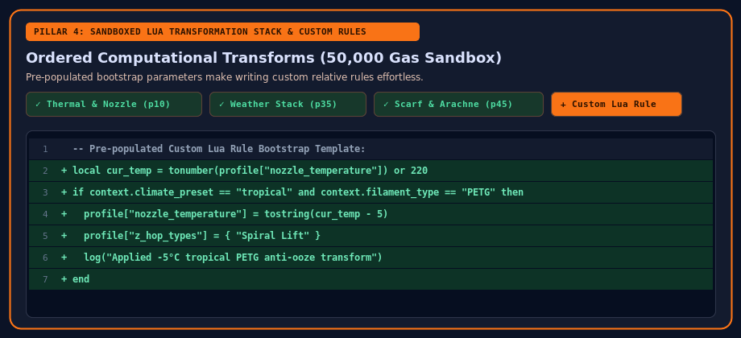

# Lua Recipes, Symptom Wizard & Diff Viewer

The **4. Wizard / Lua Changer** tab lets you diagnose print quality defects, stack pre-built calibration recipes, write custom sandboxed Lua transformations, and inspect the exact parameter changes before exporting.



## Built-In Lua Transformation Stack

Every rule in the transformation stack runs inside our **pure-Rust WebAssembly Lua interpreter** (`src/lua_engine.rs`) with strict resource and security sandboxing (`50,000` gas limit, `10,000` token limit, zero host filesystem/OS access).

Default stack rules include:

1. **Thermal Conductivity & Nozzle Material Rule** (`priority: 10`) — Adjusts nozzle temperatures, retraction length, and volumetric flow for Hardened Steel, Diamondback PCD, Ruby-Brass, and MicroSwiss FlowTech nozzles.
2. **First-Layer & Bed Adhesion Rule** (`priority: 20`) — Tunes bed temperatures and initial layer parameters for Textured PEI, Smooth PEI, and Cool Plates.
3. **Physical Rig Add-Ons & Cooling Schedule Rule** (`priority: 30`) — Scales part cooling and chamber exhaust fans for custom toolhead ducts and covers.
4. **Ambient Weather & Humidity Adaptation Rule** (`priority: 35`) — Stacks relative temperature, Z-hop (`Spiral Lift` vs `Slope Lift`), fan, brim, and volumetric flow adjustments for Tropical vs. Cold climates.
5. **Volumetric Speed Ceiling Rule** (`priority: 40`) — Dynamically caps `outer_wall_speed`, `inner_wall_speed`, and `sparse_infill_speed` to `min(hotend_max_flow, filament_max_flow) / (layer_height × line_width)`.
6. **Scarf Joint Seams & Arachne Variable Walls** (`priority: 45`) — Enables `seam_slope_type = "contour"` and Arachne perimeter generation.
7. **PETG & PCTG Anti-Stringing & Ooze Control** (`priority: 50`) — Applies inward wipe while retracting, fast travel moves, and non-crossing walls.
8. **Wet / Damp Filament — Humidity (% RH) Auto-Tuner** (`priority: 55`, disabled by default) — Automatically computes anti-steam upper-layer nozzle temperature trim, first-layer pinhole & bed-adhesion recovery (`+4..+6°C` 1st-layer bed, `1.04..1.06×` bottom flow, `30..35 mm/s`), and steam-pressure retraction from your drybox/ACE Pro `% RH` reading.
9. **⚠️ Fast-Start & Unpacked `G9111` / Bambu Lab Machine G-Code** (`priority: 58`, disabled by default — **POTENTIALLY DANGEROUS**) — Unpacks Anycubic Kobra S1's monolithic `G9111` startup macro into explicit native Kobra OS sub-macros or optimizes Bambu Lab (P1S / X1C / A1) startup & end G-code with interactive safety knobs.
10. **Upgraded Flushing Volume Matrix** (`priority: 60`) — Computes the N×N multi-material purge matrix from loaded slot colors, opacities, and polymer families.

---

## ⚠️ Fast-Start & Unpacked `G9111` / Bambu Machine G-Code (`mach_fast_start_gcode.lua` — POTENTIALLY DANGEROUS)

> **⚠️ POTENTIALLY DANGEROUS — READ BEFORE ENABLING:**
> Modifying `machine_start_gcode` or `machine_end_gcode` directly controls physical toolhead homing, nozzle wiping, strain-gauge/load-cell Z-offset probing, and multi-material filament unloading. Misconfiguring these knobs can **gouge your PEI build plate**, cause **first-layer mid-air printing**, or **crash the toolhead** at the edge of the bed:
>
> 1. **The Golden Rule — NEVER Home Z (`G28 W` / `G28 Z`) Above `140°C`**: Both the Anycubic Kobra S1 (LeviQ 2.0 strain gauge) and Bambu Lab P1S/X1C/A1 (load-cell / eddy-current nozzle tap) physically tap the nozzle tip against the build plate to establish `Z = 0`. If the nozzle is above `140°C`, softened plastic oozes from the orifice (creating a false early trigger so Layer 1 prints in mid-air) or melts permanent dimples into Textured/Smooth PEI and CryoGrip coatings. Even when you set **Pre-Wipe Nozzle Temp** to `170°C` to soften old residue, `mach_fast_start_gcode.lua` **always enforces `M109 S140` while sealed on the silicone wiper pad (`WIPE_STOP`) before `G28 W` / `G28 Z`**.
> 2. **Skipping `LEVIQ2_AUTO_ZOFFSET` (`run_leviq2_zoffset = 0`)**: Saves `~45–60s` per print by reusing the previously stored Z-offset. **NEVER disable `LEVIQ2_AUTO_ZOFFSET` after swapping build plates** (e.g. Textured PEI ↔ Smooth PEI ↔ CryoGrip) or changing nozzles, or the nozzle may dig directly into the spring steel sheet.
> 3. **Adaptive KAMP-Style Prime Line (`prime_line_mode = adaptive_kamp`)**: Draws a compact `30mm` prime strip `5mm` to the left of your model (`X = first_layer_print_min[0] - 5`). Ensure your part is placed at least `5mm` inside the left bed edge (`X >= 5mm`).

### Anycubic Kobra S1: Stock `G9111` vs. 1:1 Unpacked vs. Trimmed Safe Fast-Start

Stock Anycubic Kobra S1 profiles use a single opaque macro (`G9111 bedTemp=[first_layer_bed_temperature] extruderTemp=[first_layer_temperature[initial_tool]]`). Under the hood, Kobra OS expands `G9111` into a fixed sequence of internal firmware sub-macros:

| Step / Function | Stock `G9111` (1:1 Internal Sequence) | Trimmed Safe Mode (`kobra_s1_trimmed_safe` — Default) | Ultra-Fast Mode (`kobra_s1_ultra_fast_no_zoffset`) |
| :--- | :--- | :--- | :--- |
| **1. Initial Park & Preheat** | `TO_THROW_POSITION` (`X47 Y276`), heats nozzle to **`170°C`** to soften residue, waits for bed (`M190`). | Heats directly to **`140°C`** (`preheat_wipe_temp_c = 140`), skipping the slow `170°C → 140°C` heat-up & cool-down cycle (**saves ~60s**). | Same (`140°C` direct heat over poop chute). |
| **2. Rear Wiper & Silicone Pad** | `CLOSE_STEALTHCHOP`, `WIPE_ENTER` (`X81 Y273`), **`WIPE_NOZZLE`** (`14` rapid passes), `WIPE_STOP` (`X75 Y273` silicone pad) while cooling to `140°C`, `WIPE_EXIT`, `OPEN_STEALTHCHOP`. | Calls **`WIPE_NOZZLE1` × 2 passes** (`wipe_passes = 2`, configurable `1..14`) + `WIPE_STOP` silicone pad seal (**saves ~25s**). | Same (`WIPE_NOZZLE1` × 2 passes). |
| **3. Homing & Strain-Gauge Z-Offset** | `BED_MESH_CLEAR`, `G28 W`, and **`LEVIQ2_AUTO_ZOFFSET`** on a clean `140°C` nozzle. | Runs `BED_MESH_CLEAR`, `G28 W`, and **`LEVIQ2_AUTO_ZOFFSET`** (`run_leviq2_zoffset = 1` — **safe across plate swaps**). | ⚠️ Skips `LEVIQ2_AUTO_ZOFFSET` (`run_leviq2_zoffset = 0`, **saves ~50s** — **same plate/nozzle only!**). |
| **4. Bed Mesh Loading** | `BED_MESH_PROFILE LOAD="default"` (loads saved mesh in `0.1s` unless fresh probing is ticked on screen). | Explicitly calls `BED_MESH_PROFILE LOAD="default"` after `M400`. | Explicitly calls `BED_MESH_PROFILE LOAD="default"`. |
| **5. Final Heat & Prime** | `TO_THROW_POSITION`, `M109 S[first_layer_temperature[initial_tool]] I1`, front purge line (`Y1 X180 E40 F500`). | Stock front purge line (`stock_front`) or Adaptive KAMP `30mm` line (`adaptive_kamp`). | Stock front purge line or Adaptive KAMP `30mm` line. |

#### Full 1:1 Unpacked `G9111` G-Code (`startup_preset = "kobra_s1_unpacked_1to1"`)

```gcode
; --- 1:1 Unpacked G9111 Sequence for Anycubic Kobra S1 ---
G90 ; Absolute positioning
M83 ; Relative extrusion

; 1. Park over poop chute and preheat
M140 S[first_layer_bed_temperature] ; Start heating bed in background
TO_THROW_POSITION ; Move to poop chute (X47 Y276)
M109 S170 ; Heat nozzle to 170C to soften residue before wipe
M190 S[first_layer_bed_temperature] ; Wait for bed temp

; 2. Native Rear Wiper & Silicone Pad Routine
CLOSE_STEALTHCHOP STEPPER=stepper_x
CLOSE_STEALTHCHOP STEPPER=stepper_y
WIPE_ENTER ; Move to wiper entry (X81 Y273)
WIPE_NOZZLE ; Execute 14x native brush wipe
WIPE_STOP ; Park on silicone pad (X75 Y273) to seal nozzle against oozing
M109 S140 ; GOLDEN RULE: Cool nozzle to 140C on silicone pad before Z-homing!
WIPE_EXIT ; Exit wiper area (X83 Y250)
OPEN_STEALTHCHOP STEPPER=stepper_x
OPEN_STEALTHCHOP STEPPER=stepper_y

; 3. Homing, Auto Z-Offset & Saved Bed Mesh
BED_MESH_CLEAR ; Clear active mesh before probing
G28 W ; Home all axes with clean 140C nozzle
LEVIQ2_AUTO_ZOFFSET ; Measure & apply strain-gauge Z-offset on clean 140C nozzle
M400 ; Wait for moves to finish
BED_MESH_PROFILE LOAD="default" ; Load saved bed mesh in 0.1s

; 4. Final Heat to First-Layer Print Temp
TO_THROW_POSITION ; Park over poop chute during final heat
M109 S[first_layer_temperature[initial_tool]] I1 ; Wait for 1st-layer nozzle temp

; 5. Stock Anycubic Front Purge Line
G90
G1 Z0.28 F1200
G92 E0
G1 X20 Y1 F6000
G1 X180 E40 F500
M400
G92 E0
G1 E-0.5 F300
M400
M117
```

---

### Bambu Lab (P1S / X1C / A1) Fast-Start & Same-Spool AMS Optimizations

Stock Bambu Lab startup routines take **4.5 to 7 minutes** before Layer 1 begins. Combining **Level 1 (Zero-Code Checkboxes)** with **Level 2 (`mach_fast_start_gcode.lua` Bambu Presets)** cuts startup time to **~60–90 seconds**:

1. **Level 1 — Zero-Code Send-Print Dialog Checkboxes (Saves ~2–3 Minutes)**:
   - **Uncheck "Bed Leveling"**: Reuses the stored bed mesh in `0.1s` via `G29 A` instead of probing 36–64 points across the plate (`~90–120s` saved). Re-run bed leveling only when swapping build plates.
   - **Uncheck "Flow Dynamics / Flow Calibration"** (X1C / A1): Once Pressure Advance (`k`) and Flow Ratio are stored in your filament preset, skipping the pre-print LiDAR/eddy calibration lines saves `~60–90s` and front-of-bed space.
2. **Level 2 — Bambu Fast-Start & End G-Code Knobs (`bambu_fast_start` / `bambu_fast_same_spool`)**:
   - **Parallel Bed Heating (`bambu_parallel_bed_heat = 1`)**: Starts bed heating in the background (`M140 S[bed_temperature_initial_layer_single]`) while homing XY and wiping the nozzle, waiting (`M190`) only right before `G28 Z` (**saves ~45–60s**).
   - **Skip Mech Mode Fast Check (`bambu_skip_mech_check = 1`)**: Removes the loud `;===== mech mode fast check =====` XY resonance buzz sweep before every print (**saves ~20s + noise**).
   - **Adaptive KAMP-Style `30mm` Prime Line (`prime_line_mode = adaptive_kamp`)**: Extrudes a short `30mm` prime line at `X = first_layer_print_min[0] - 5`, `Y = first_layer_print_min[1] .. +30` right next to the part so travel to the skirt/brim is `<5mm`.
   - **⚠️ Keep AMS Filament Loaded at Print End (`keep_ams_loaded_at_end = 1`)**: Comments out `M620 S255` / `T255` / `M621 S255` in `machine_end_gcode` so the active spool is **not** cut and retracted back into the AMS after a print finishes (**saves ~90s + ~50mm of purged filament poop** on back-to-back single-color prints).

### Multi-Tab Machine G-Code Optimizations (Start, End, Change Filament & Before Layer)

Beyond speeding up initial homing, `mach_fast_start_gcode.lua` tunes all **four active Machine G-Code tabs** (`machine_start_gcode`, `machine_end_gcode`, `change_filament_gcode`, and `before_layer_change_gcode`) plus Kobra S1's factory filament bottlenecks:

| Slicer G-Code Tab | Optimization Applied by `mach_fast_start_gcode.lua` | Primary Benefit |
| :--- | :--- | :--- |
| **`machine_start_gcode`** | Direct `140°C` preheat + `N×` wipe + **Conditional ABS/ASA Heat-Soak** (before probing) + **Textured PEI (`-0.03mm`) / PETG (`+0.02mm`) Z-Offset** (after probing) | Faster PLA/PETG starts, zero ABS bed-bow warping, dialed-in 1st-layer squish |
| **`change_filament_gcode`** | **Long Retract Before Cut** (`G1 E-14 F1200` before `T[next_extruder]` on Kobra S1 + `0.65×` flush; `G1 E-18 F1200` on Bambu AMS + `0.60×` flush) | **35–45% less multi-color filament poop** without color bleed |
| **`machine_end_gcode`** | **`E-5`/`E-6` Anti-Ooze Retract** at top + **Smart `Z150` Bed Drop** + **Silence `M106 P2/P3` Fans** + optional **Keep AMS Loaded** | Bone-dry nozzle tip for next print's strain-gauge `G28 Z`, easy plate removal, quiet idle |
| **`before_layer_change_gcode`** | Removes Anycubic Slicer Next's redundant `{if layer_num==0} ; PURGE LINE ... Y255` rear strip on Kobra S1 | Prevents rear-edge plastic build-up and nozzle dragging on Layer 0 |

#### 1. Long Retract Before Cut (`change_filament_gcode` — Cuts Multi-Color Poop by ~45%)

When an AMS or ACE Pro swaps colors, the cutter slices the filament right above the hotend melt zone, leaving `~18–20mm` of molten polymer trapped in the nozzle. Pulling `14mm` (Kobra S1 before `T[next_extruder]`) or `18mm` (Bambu Lab before cutter actuation) of melted filament up out of the melt zone leaves the nozzle nearly empty for the next spool:

```gcode
; --- Kobra S1 Change Filament G-Code (with 0.65× Flushing Volumes Multiplier) ---
; FLUSH_START
M400
G92 E0
G1 E-14 F1200 ; Pull 14mm of molten filament up out of the melt zone before cutter strikes
G92 E0
T[next_extruder] ; change extruder (ACE Pro internal cut & purge)
; FLUSH_END
```

#### 2. Conditional Plate & PETG Z-Offset Compensation (`machine_start_gcode` — AFTER `G9111` / `LEVIQ2_AUTO_ZOFFSET`)

Textured PEI sheets have microscopic peaks and valleys: when the nozzle taps the peaks during Z-homing, the true valley surface sits slightly lower, needing `-0.03mm` extra squish. Conversely, PETG prefers `+0.02mm` extra clearance so it does not fuse to smooth plates or collect blobs on the nozzle tip.

* **Crucial Kobra S1 Rule**: On the Kobra S1 (which runs Klipper under the hood), `SET_GCODE_OFFSET` **must** be placed **after** `G9111` or `LEVIQ2_AUTO_ZOFFSET`, because `G9111` resets the Z-offset during its probing phase:

```gcode
; --- Kobra S1 / Klipper (Placed AFTER G9111 or LEVIQ2_AUTO_ZOFFSET) ---
{if curr_bed_type=="Textured PEI Plate"}
  SET_GCODE_OFFSET Z_ADJUST=-0.03 MOVE=1 ; Squish 0.03mm closer into textured PEI valleys
{endif}
{if filament_type[initial_tool]=="PETG"}
  SET_GCODE_OFFSET Z_ADJUST=+0.02 MOVE=1 ; Raise 0.02mm so PETG doesn't stick to nozzle
{endif}

; --- Bambu Lab (Placed AFTER G28 Z) ---
{if curr_bed_type=="Textured PEI Plate"}
  G29.1 Z-0.03 ; Squish 0.03mm closer into textured PEI valleys
{endif}
{if filament_type[initial_extruder]=="PETG"}
  G29.1 Z+0.02 ; Raise nozzle 0.02mm for PETG to prevent nozzle buildup
{endif}
```

#### 3. Conditional Chamber Heat-Soak for ABS / ASA (`machine_start_gcode` — BEFORE `G9111` / Probing)

Placing an `{if}` heat-soak block **before** `G9111` / `G28 Z` warms the enclosed chamber and lets the `250×250mm` aluminum bed finish thermally bowing *before* the strain gauge taps the center of the plate—while adding **zero seconds** to PLA, PETG, or TPU prints:

```gcode
; --- Put BEFORE G9111 / Probing in Kobra S1 Machine Start G-Code ---
{if filament_type[initial_tool]=="ABS" or filament_type[initial_tool]=="ASA"}
  M140 S[first_layer_bed_temperature] ; Start heating bed to 100C+
  M106 P2 S180 ; Run Kobra S1 Aux Fan at 70% to circulate heat off the bed
  G28 ; Quick home so we can park near the bed
  G1 X125 Y125 Z15 F6000 ; Center toolhead over bed
  M190 S[first_layer_bed_temperature] ; Wait for bed sensor to hit target
  G4 S240 ; Heat-soak for 4 minutes (240s) so aluminum bed expansion stabilizes
  M106 P2 S0 ; Turn off Aux fan before starting Z-offset probing
{endif}
```

#### 4. Anti-Ooze End Retraction (`E-5`/`E-6`), Smart `Z150` Bed Drop & Silence Exhaust Fans (`machine_end_gcode`)

Pulling the filament back `5–6mm` at the **very top** of `machine_end_gcode` relieves nozzle pressure before the toolhead parks over the poop chute (`X44 Y270`), preventing a hardened plastic icicle from ruining the strain-gauge `G28 Z` tap on your next print:

```gcode
; --- Put at the VERY TOP of Kobra S1 Machine End G-Code ---
M400 ; Wait for final print move to complete
G92 E0
G1 E-5 F1800 ; Retract 5mm immediately to prevent nozzle oozing while cooling
G91 ; Relative positioning
G1 Z2 F2400 ; Lift Z 2mm cleanly off the print
G90 ; Back to absolute positioning

; Smart Z150 Bed Drop Height
{if max_layer_z < 140}
  G1 Z150 F3000 ; Drop bed to clean, comfortable 150mm reach height
{elsif max_layer_z < max_print_height-1}
  G1 Z{z_offset+min(max_layer_z+10, max_print_height)} F900
{endif}
G1 F12000 ; present print
G1 X44 ; throw_position_x
G1 Y270 ; throw_position_y
M140 S0 ; turn off heatbed
M104 S0 ; turn off temperature
M106 S0 ; turn off part cooling fan
M106 P1 S0 ; turn off fan P1
M106 P2 S0 ; turn off Aux fan
M106 P3 S0 ; turn off Chamber exhaust/filter fan
M84 ; disable stepper motors
```

#### 5. Stock Kobra S1 Firmware Restrictions & Workarounds (ACE Pro vs. Rinkhals)

| Optimization | Stock Kobra S1 Firmware Behavior | The Kobra S1 Solution |
| :--- | :--- | :--- |
| **1. Long Retract Before Cut (`Change filament G-code`)** | ACE Pro cutter actuation and purge loop are wrapped inside firmware's `T[next_extruder]` macro. | Put `G92 E0` + `G1 E-14 F1200` + `G92 E0` at the **very top** of `Change filament G-code` *before* `T[next_extruder]`, and lower **Flushing Volumes multiplier to `0.65`**. |
| **2. Keeping ACE Pro Filament Loaded After Print** | At the end of an ACE Pro print, stock firmware automatically cuts and retracts the spool back to the buffer. | For single-color back-to-back runs, disable the end-print unload call or override `END_PRINT` via **Rinkhals**. |
| **3. Manual Mid-Print Color Swap (`PAUSE` / `M600` on External Spool)** | Stock Kobra OS parks over the chute, **greys out Extrude/Retract on the touchscreen**, and ignores manual `G1 E40` purge moves on resume. | **Hardware Workaround**: Press the lower cutter lever on the right of the extruder, then hold the upper tension lever while pushing the new filament through by hand until it purges.<br>**Rinkhals Workaround**: Use the Mainsail/Fluidd web UI where Extrude/Retract remain unlocked during `PAUSE`. |

#### 6. Non-G-Code Kobra S1 Bottleneck Fixes (`kobra_unbottleneck_petg_abs = 1`)

Community testing on the Kobra S1 (notably the **MPC561** and **Kreativling** profiles) identified two major factory filament bottlenecks that `kobra_unbottleneck_petg_abs = 1` fixes automatically across both `.3mf` and standalone `.json` exports:

1. **Lower PETG Retraction Distance (`1.5mm` → `0.70mm`)**: Anycubic's stock Kobra S1 PETG profile sets `filament_retraction_length = 1.5mm`, which is far too long for the S1's short direct-drive hotend and pulls air pockets that leave Z-seam holes/pockmarks. Dropping retraction to **`0.70mm`** (`0.6–0.8mm` sweet spot) eliminates seam gaps.
2. **Uncap Volumetric Flow Rate on PETG (`19.0 mm³/s`) & ABS/ASA (`23.0 mm³/s`)**: Anycubic artificially throttled stock PETG and ABS profiles to `12–15 mm³/s`. The Kobra S1 hotend easily sustains **`18–20 mm³/s` on PETG** and **`22–25 mm³/s` on ABS/ASA**, cutting print times by 25–35% on larger functional parts.

### Interactive Knobs Reference (`mach_fast_start_gcode.lua`)

| Knob ID | Parameter Label | Default | Options / Range |
| :--- | :--- | :--- | :--- |
| `startup_preset` | **1. Complete Machine G-Code Preset** | `kobra_s1_trimmed_safe` | `kobra_s1_trimmed_safe`, `kobra_s1_ultra_fast_no_zoffset` (⚠️), `kobra_s1_unpacked_1to1`, `stock_g9111`, `bambu_fast_start`, `bambu_fast_same_spool` (⚠️), `custom` |
| `printer_family` | **2. Printer Firmware Architecture** | `kobra_s1` | `auto` (detects from Rig model), `kobra_s1`, `bambu_lab` |
| `preheat_wipe_temp_c` | **3. Start: Initial Pre-Wipe Nozzle Temp (°C)** | `140°C` | `135°C – 170°C` (Always cools back to `140°C` on silicone pad before Z-homing!) |
| `wipe_passes` | **4. Start: Rear Nozzle Wiper Passes** | `2` | `1 – 14` passes (`1..13` emits `WIPE_NOZZLE1` × $N$; `14` emits `WIPE_NOZZLE`) |
| `run_leviq2_zoffset` | **5. ⚠️ Start: Strain-Gauge Auto Z-Offset (`LEVIQ2_AUTO_ZOFFSET`)** | `1` (Safe) | `1` (Run every print — Safe), `0` (⚠️ Skip to save ~50s — **same plate/nozzle only!**) |
| `conditional_z_offset` | **6. Start: Auto Textured PEI (`-0.03mm`) & PETG (`+0.02mm`) Z-Offset** | `1` | `1` (Emit `SET_GCODE_OFFSET` / `G29.1` after probing), `0` (Off) |
| `chamber_heat_soak_abs` | **7. Start: Auto 4–5 Min Chamber Heat-Soak for ABS / ASA** | `1` | `1` (Run 70% Aux fan heat-soak before probing on ABS/ASA only), `0` (Off) |
| `prime_line_mode` | **8. Start: Purge / Prime Line Strategy** | `stock_front` | `stock_front` (`Y1 X20→X180`), `adaptive_kamp` (⚠️ `30mm` line at `first_layer_print_min[0]-5`) |
| `long_retract_before_cut` | **9. Change Filament: Long Retract Before Cut (Poop-Saver)** | `auto` | `auto` (Kobra `E-14` & `0.65×` / Bambu `E-18` & `0.60×`), `kobra_14mm`, `bambu_18mm`, `off` |
| `anti_ooze_end_retract` | **10. End: Anti-Ooze Retract (`E-5`/`E-6`) & Silence Fans** | `1` | `1` (Immediate `E-5`/`E-6` + `Z+2` hop + `M106 P2/P3 S0`), `0` (Stock `E-2`) |
| `smart_end_bed_park` | **11. End: Smart `Z150` Bed Drop Height** | `1` | `1` (`Z150` comfortable reach height), `0` (Stock `max_layer_z + 2`) |
| `keep_ams_loaded_at_end` | **12. ⚠️ End: Keep AMS / ACE Pro Filament Loaded** | `0` (Safe) | `0` (Normal cut & unload), `1` (⚠️ Keep filament loaded at print end for same-spool reprints) |
| `remove_kobra_rear_purge_line` | **13. Before Layer: Remove Kobra S1 `Y255` Rear Purge Strip** | `1` | `1` (Remove redundant Layer-0 `Y255` purge line), `0` (Keep stock) |
| `kobra_unbottleneck_petg_abs` | **14. Kobra S1 Fix: PETG (`0.70mm` Retract, `19 mm³/s`) & ABS (`23 mm³/s`)** | `1` | `1` (Apply MPC561/Kreativling PETG & ABS/ASA fix), `0` (Off) |
| `bambu_skip_mech_check` | **15. Bambu Lab: Skip Resonance Buzz Sweep** | `1` | `1` (Skip `mech mode fast check`), `0` (Keep stock buzz check) |
| `bambu_parallel_bed_heat` | **16. Bambu Lab: Parallel Bed Preheat** | `1` | `1` (`M140` during XY home/wipe + `M190` before `G28 Z`), `0` (Sequential `M190`) |

## Custom Lua Rules with Pre-Populated Bootstrap Template

Clicking **+ Create / Add Lua Rule → Custom Lua Script** pre-populates a complete, runnable Lua template demonstrating:
- Reading hardware and weather context (`context.nozzle_type`, `context.filament_type`, `context.climate_preset`, `context.ambient_temp_c`).
- Applying relative numeric offsets (`tonumber(profile["nozzle_temperature"]) + 5`) and array overrides (`profile["z_hop_types"] = { "Spiral Lift" }`).
- Logging audit messages via `log("...")`.

## Diff & Parameter Provenance / Lineage Inspector (Lineage Pipeline, GitHub Unified & Side-by-Side)

At the bottom of **1. Overview & Config Sync** (and inside **4. Wizard & Lua Rules**), the **Diff & Parameter Provenance / Lineage Inspector** compares the **System Base JSON** against the **Re-Created Output JSON** with three interactive views:

- **🧬 Provenance & Lineage Mode**:
  - Visualizes the complete, non-commutative computation chain for every parameter:
    $$\text{Stage 0 Origin Baseline} \xrightarrow{\text{Step \#1 Rule }(\Delta_1)} \text{Intermediate Value} \xrightarrow{\text{Step \#2 Rule }(\Delta_2)} \dots = \text{Final Derived Output }(\text{Net }\Delta)$$
  - Displays each step's **Rule Name, Icon, Category, Execution Step `#k`, Priority `#P`, Before → After values, additive & multiplicative delta summary** (e.g. `+5 °C (+2.2% • 1.02×)`), and the **Lua Audit Log** emitted by `print(...)` during rule evaluation.
  - Includes instant filters for **Modified Lineage**, **Multi-Rule Chains (≥2 Steps)**, and **All Catalog Params**, plus a real-time search box and inline expandable rows in the **Re-Created Overrides vs System Base Defaults** table.
- **GitHub / Unified Diff Mode**: Highlights removed base lines in red (`- ...`) and transformed lines in green (`+ ...`) with a toggle for **Changed Lines Only** vs. **Full JSON**.
- **Side-by-Side Mode**: Displays the System Base JSON on the left and the Re-Created Output JSON on the right in synchronized rows.
